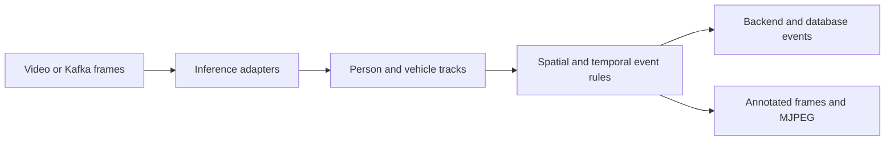

# Industrial Video Event Analytics

**An industrial computer-vision pipeline that connects video/Kafka frames, object inference, tracking and scene-specific spatial/temporal event rules.**

Object detections become operationally useful when they explain events over time: a person entering a restricted region, an interaction with a vehicle, or an unsafe relative position. This implementation keeps frame acquisition, inference, track state, event rules and output adapters in separate modules so that domain rules can be examined independently of the detector.

## Architecture and data flow



## Implementation decisions

1. Readers isolate file/stream acquisition and Kafka transport from downstream object processing. Detector outputs feed tracking rather than being treated as persistent identities.

2. Event logic uses boxes, masks, polygons and track history. Pixel distances and derived speed thresholds are scene-dependent configuration, not camera-independent physical measurements.

3. The feet_in_zone predicate is shared by the live danger-zone rule and deterministic replay. It tests the relevant box region against a configured zone rather than replacing the video system with a separate demo algorithm.

4. Object inference and temporal event quality are different evaluation layers. A detection mAP score alone would not establish event precision or false alarms per hour.

5. The repository separates application source from external detector weights and industrial recordings. Model licenses and permission to publish footage need independent review.

6. Hydra configuration exposes the scene and infrastructure boundary. Backend and Kafka connection values come from environment references rather than a customer deployment.

## Source navigation

| Module | Responsibility |
| --- | --- |
| `main.py` | Hydra entry point and processing loop |
| `src/services/readers` | Video and Kafka frame acquisition |
| `src/services/inferencer` | Model inference adapters |
| `src/services/tracker` | Track state and motion information |
| `src/utils/tasks_logic.py` | Scene-specific event rules |
| `src/utils/zone_events.py` | Shared danger-zone predicate |
| `src/services/backend_api_client.py` | Event delivery adapter |

## Reproducible component checks

The minimal checks use Python 3.11/3.12 and `requirements-checks.txt`. They are independent of live accounts, paid APIs and GPU inference. They exercise the specific boundary described below; they are not a measurement of the complete application's model quality.

Linux/macOS, from the repository root:

```bash
python3.11 -m venv .venv
.venv/bin/python -m pip install -r requirements-checks.txt
.venv/bin/python offline_demo.py
.venv/bin/python -m unittest discover -s tests/offline -v
.venv/bin/python scripts/check_source.py
```

Windows PowerShell, from the repository root:

```powershell
py -3.11 -m venv .venv
& ./.venv/Scripts/python.exe -m pip install -r requirements-checks.txt
& ./.venv/Scripts/python.exe offline_demo.py
& ./.venv/Scripts/python.exe -m unittest discover -s tests/offline -v
& ./.venv/Scripts/python.exe scripts/check_source.py
```

### What the replay actually verifies

Four generated box positions reproduce an outside → inside → inside → outside sequence through the same predicate used by the live rule. Additional checks cover polygons, boundary thresholds, degenerate detections and IoU. The replay does not run a detector, associate real tracks or process an industrial video.

The recorded example output is in [docs/offline-demo-output.json](docs/offline-demo-output.json). CI checks the minimal suite separately from a Gitleaks secret scan. Source compilation verifies syntax; it does not instantiate every runtime integration.

## Full runtime and configuration

The full stack uses PyTorch/torchvision, Ultralytics, GPU ONNX Runtime, OpenCV, Hydra and Kafka. Review the preserved implementation guide before selecting compatible Torch/CUDA builds. Set authorized local weight/video paths in `src/config/config.yaml`; the live entry point is `python main.py`. The Compose entry point invokes this script. Hydra environment references use `${oc.env:NAME}`; they are not Docker Compose substitution syntax.

Runtime dependencies and configuration notes are documented in [docs/runtime.md](docs/runtime.md). Minimal and full-runtime environments are intentionally separate. Filled local settings, credentials, production exports and original Git history are outside the source export. Configuration examples describe shape and environment references; they are not a working customer account.

## Evaluation protocol

Use camera-separated or time-separated authorized recordings with event intervals, track labels and explicit annotation rules. Report event precision/recall, false alarms per hour, time-to-detection and end-to-end delay. Analyze occlusion, partial entry, missed tracks and boundary jitter. Detector, tracker and event-rule failures should be distinguishable.

## Current boundaries

- No independently labeled industrial event benchmark is included.
- Deployment requires model weights, compatible acceleration libraries and calibrated scene parameters.
- Offline geometry checks do not establish safety certification or field performance.

This repository presents the reviewed, anonymized source and the reproducible component checks described above. Private account configuration, customer identities, production documents, recordings and original deployment settings are excluded. Full application-level evaluation remains separate from the offline checks.

## Provenance and dependencies

The source export belongs to the author's local project family; technical component boundaries are recorded in [docs/source-provenance.json](docs/source-provenance.json). Third-party libraries, pretrained models and adapters retain their own licenses and attribution; see [THIRD_PARTY.md](THIRD_PARTY.md). No new permissive license is assigned by this documentation update.

Where present, [docs/original-guide.md](docs/original-guide.md) preserves the implementation guide with neutralized service names. It is reference material and must be read together with the current runtime and validation boundaries above. It is not a claim of production readiness.
